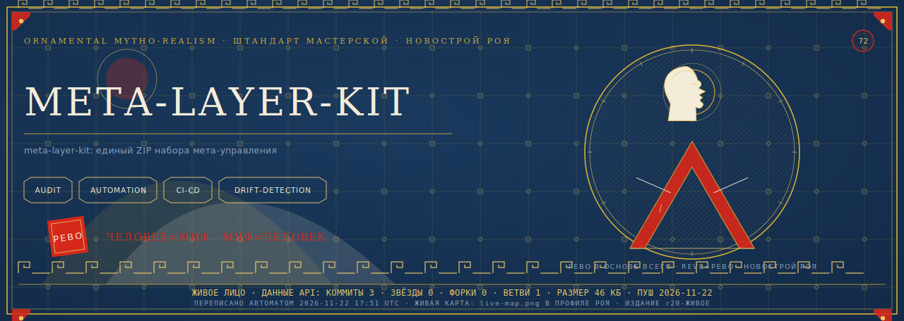
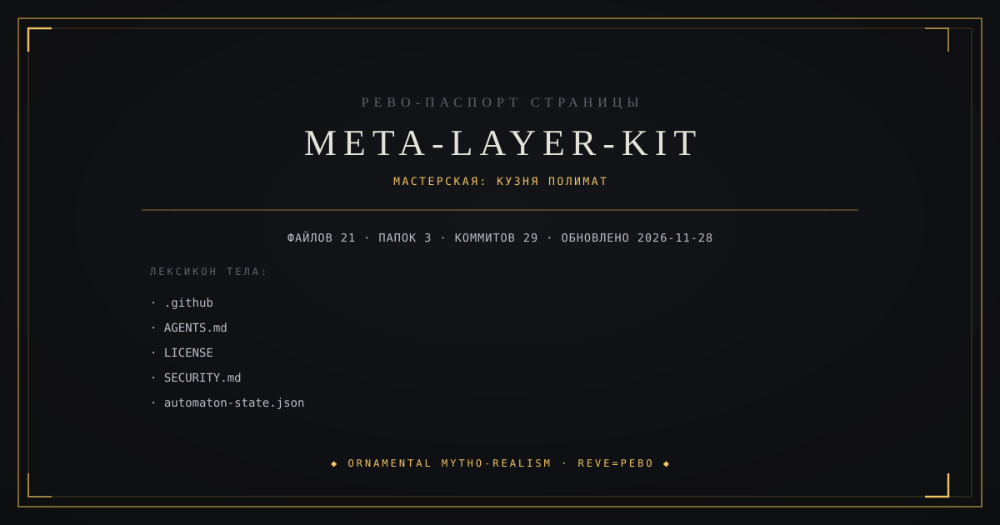

<div align="center">

<a href="https://github.com/rtynbirf/meta-layer-kit"></a>

</div>

<!--ФОРЖ:ПАСПОРТ:НАЧАЛО-->
<div align="center">
  
</div>

| ФАЙЛОВ | ПАПОК | КОММИТОВ | ОБНОВЛЕНО | РЕЛИЗОВ |
|---:|---:|---:|---|---:|
| 15 | 1 | 8 | 2026-11-23 | 0 |
<!--ФОРЖ:ПАСПОРТ:КОНЕЦ-->

# meta-layer-kit · ЕДИНЫЙ ZIP НАБОРА МЕТА-УПРАВЛЕНИЯ

> 1 смысл = 1 репо: здесь живёт единый ZIP комплекта мета-управления домом — и ничего больше.
> Для кого: для Хозяина и роя агентов, которые ставят мета-слой (карта дома + дрейф-гейт + CI) одним архивом.
> Отличие от соседей: `karta`/`inv-automat` считают карту по живому API на месте; этот кит — переносимый архив инструментов: `meta-layer` (карта+дрейф), `cosmos-kit` (учебная орбита), `universe-toolkit` (приватный слой по ключу владельца).

## Заявление — артефакт — верификатор (E-GATE)

| Элемент | Факт |
|---|---|
| Заявление | Комплект собран, целостен, выложен в дом и совпадает с верстаком бит-в-бит |
| Артефакт | `prorab-pack.zip` (пломба ниже), первый коммит кита `5c78dcfb` |
| Верификатор | байт-сверка анонимного скачивания из дома с локальной пломбой; CI-гейт репо: `sha256sum -c` + офлайн-дрейф из `api-capture.json` |
| Статус зрелости | целостность ZIP: **проверено** (пломба 2026-11-22) · инструменты кита: **прототип** |

## Контроль целостности

```
69286688d9215a8f541837cd5f73004565f0ddea8bd105730f6ffeaf4dc934bf  prorab-pack.zip
```

## Состав архива

| Папка | Смысл |
|---|---|
| `meta-layer/` | мета-карта дома: `MAP.md` + `map.json` + дрейф-гейт `meta_snapshot.py` + `bootstrap.sh` (сборка мета-репо одной командой) |
| `cosmos-kit/` | учебная орбита: CI-манифесты, снапшот, демо-вселенная с тестами |
| `universe-toolkit/` | приватный слой: снимается только ключом владельца (`zapusk.sh`) |
| `meta-build-log.txt`, `cosmos-build-log.txt` | журналы сборки с пломбами прогонов |

## Как поставить

```bash
unzip prorab-pack.zip && cd meta-layer
bash bootstrap.sh --dry-run   # сухой прогон: без ключа и пуша
bash bootstrap.sh             # живой прогон: ключ — скрытый ввод
```

Правила работы в этом репо — `AGENTS.md`; уязвимости — `SECURITY.md`; лицензия — `LICENSE`.
